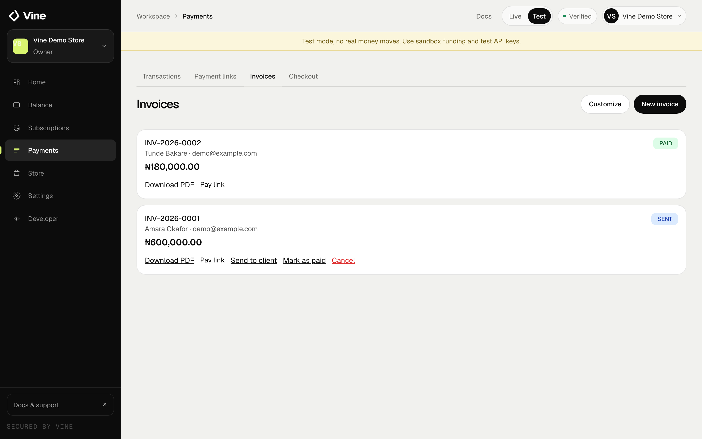
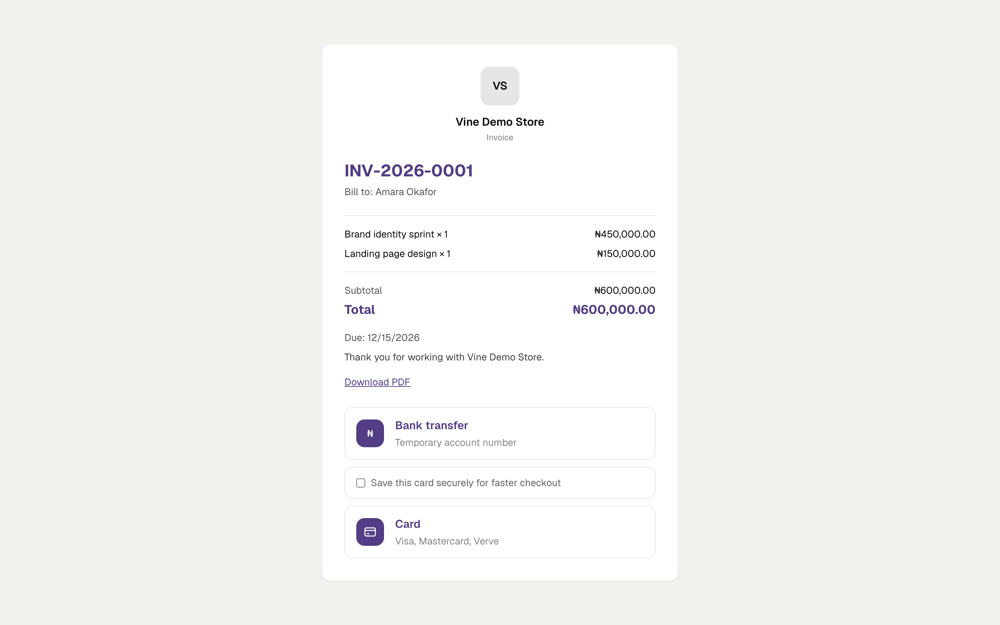

Use invoices when you need to bill a client with line items, a due date, tax and payment terms.

<Frame caption="Invoices in the dashboard, with paid and sent states and a shareable pay link.">
  
</Frame>

## Create an invoice

<Steps>
  <Step title="Open Invoices">
    In the dashboard, go to **Invoices** and choose **New invoice**.
  </Step>
  <Step title="Add the client">
    Enter the client name and email. Add a phone number or address if you need it on the invoice.
  </Step>
  <Step title="Add line items">
    Choose NGN or USD, then add a description, quantity and unit price for each item. Vine calculates the subtotal.
  </Step>
  <Step title="Set terms">
    Choose a due date, add tax if needed, and add notes or payment instructions.
  </Step>
  <Step title="Send it">
    Save the invoice and choose **Send**. Your client receives the invoice and a secure payment link.
  </Step>
</Steps>

## Invoice status

Invoices move through these states:

- **Draft:** created but not sent.
- **Sent:** delivered to the client and awaiting payment.
- **Paid:** payment has been confirmed.
- **Overdue:** the due date has passed without payment.
- **Cancelled:** no longer collectable.

You can mark an invoice as paid manually when you have received payment outside Vine.

<Frame caption="The invoice page your client opens. It includes the line items, totals, due date and payment methods.">
  
</Frame>

## Branding and defaults

Open **Settings → Branding** to set:

- Your logo on invoices.
- A brand colour for invoice accents.
- The invoice prefix and default payment terms.
- A footer message on invoices and receipts.

## Fees

NGN invoices cost **1.5% per successful collection**, capped at **₦3,000**. USD invoices use **4.5% for cards** and **1% for stablecoins**. Nothing is charged for creating or sending an invoice.
