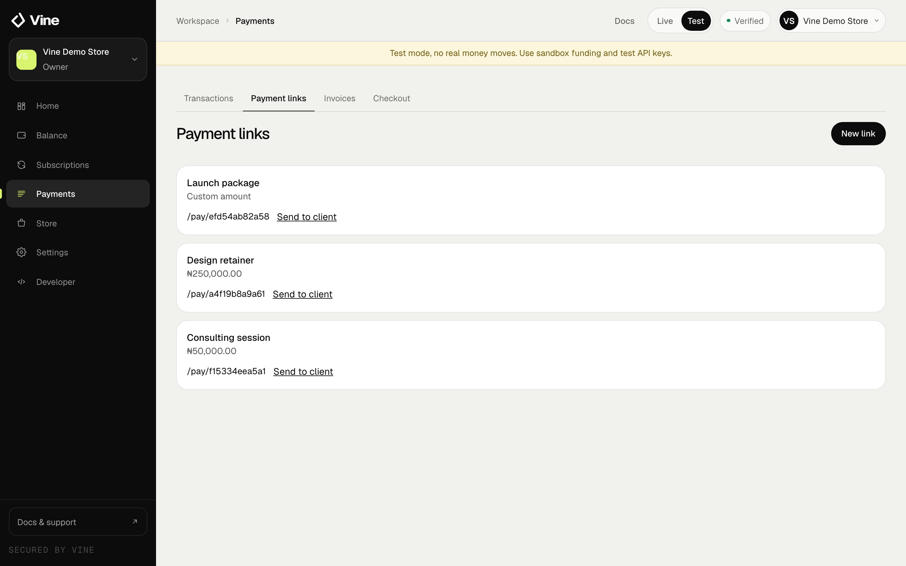
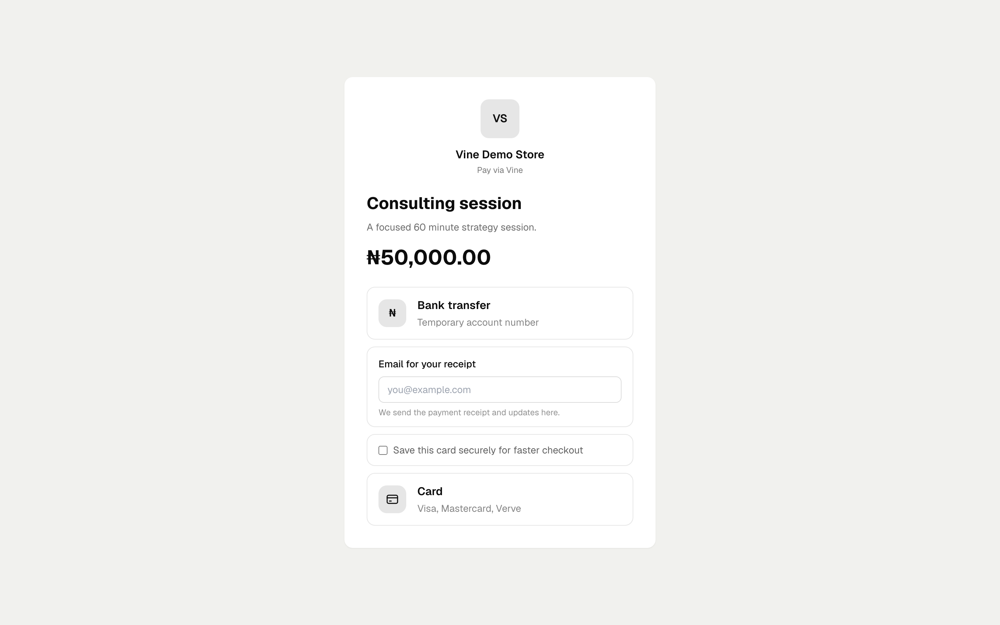

A payment link is the fastest way to collect money. Create it once, share it anywhere, and let the customer choose how to pay.

<Frame caption="Payment links in the dashboard. Each link has a shareable pay URL and a send-to-client action.">
  
</Frame>

## Create a link

<Steps>
  <Step title="Open Payment links">
    In the dashboard, go to **Payment links** and choose **New link**.
  </Step>
  <Step title="Add the details">
    Give the link a title and optional description. Choose NGN or USD, then set a fixed amount or let the customer enter the amount.
  </Step>
  <Step title="Choose payment methods">
    Enable bank transfer, card, crypto, or any combination that fits the sale. Bank transfer is available for NGN links only.
  </Step>
  <Step title="Add advanced options">
    Turn on tipping to let the customer add a tip, and add a redirect URL to send them to your website after payment.
  </Step>
  <Step title="Share the link">
    Copy the link and send it by WhatsApp, email, social media, or your website.
  </Step>
</Steps>

## What the customer sees

The customer opens a Vine-hosted page with your business name and the amount. They choose a payment method and complete payment on Vine.

<Frame caption="What a customer sees when they open a payment link.">
  
</Frame>

<Note>
  Never ask a customer to send card details in a chat or email. Card details are entered on Vine and are not stored by Vine.
</Note>

## Track payments

The Payment links page shows each link, its status and the payments it has collected. Open a link to see its payment history.

## Fees

NGN payment links cost **1.5% per successful collection**, capped at **₦3,000**. USD links use **4.5% for cards** and **1% for stablecoins**. Failed or abandoned payments are not charged.

See [pricing](https://vine.ng/pricing) for the current fee schedule.
