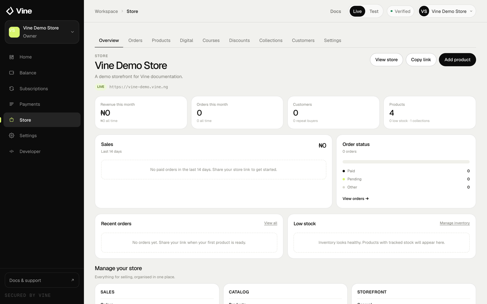
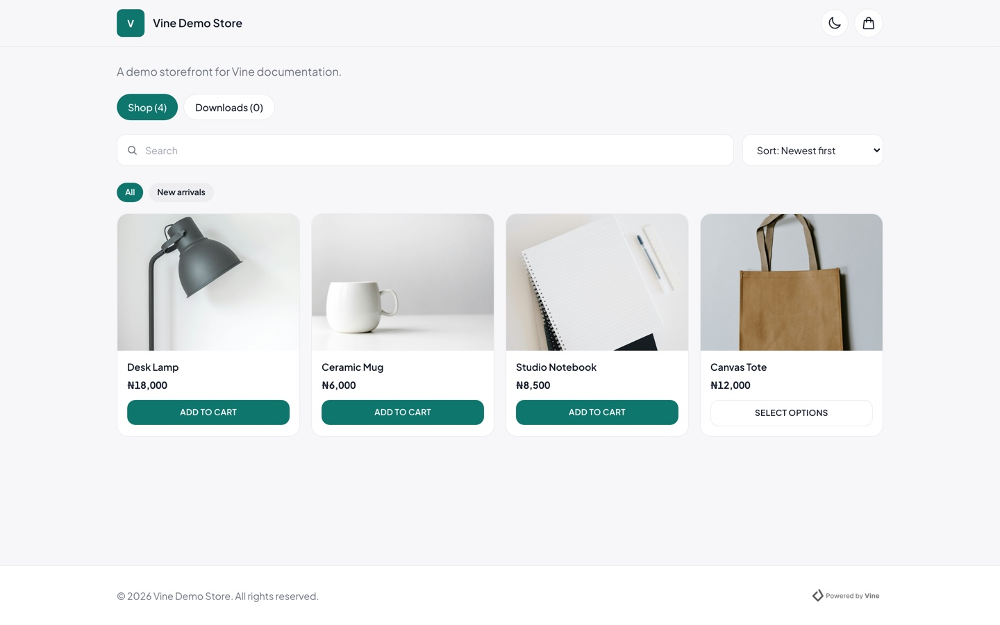
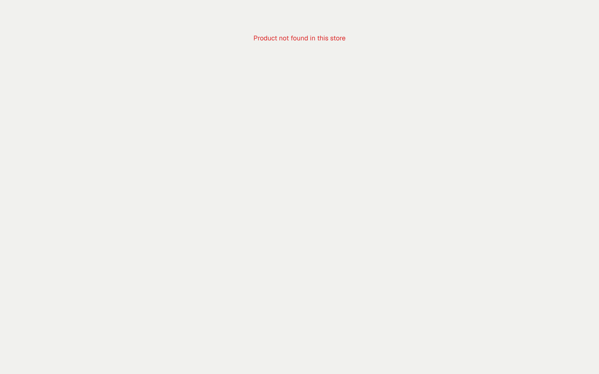
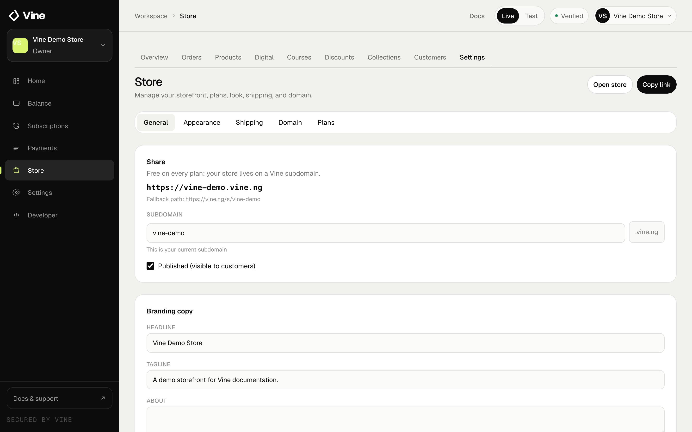

Your storefront turns Vine into a simple online shop. Every business gets a Vine subdomain and can connect a custom domain.

Every account tier can create and manage a basic storefront for free, including freelancers. Live payments still require identity verification.

<Frame caption="The Store overview brings sales, orders, customers and inventory into one place.">
  
</Frame>

## Set up your storefront

Your store is not created until you finish the guided setup. Open **Store** in the dashboard and follow the four steps:

<Steps>
  <Step title="Name your store">
    Enter the store name customers will see and choose your free `your-business.vine.ng` link.
  </Step>
  <Step title="Pick a look">
    Choose a starting theme. You can change the theme, colours and layout later in **Store → Appearance**.
  </Step>
  <Step title="Choose what you sell">
    Turn shop products, digital downloads and courses on or off.
  </Step>
  <Step title="Review and create">
    Check the details, then create your store. You can publish immediately or keep it as a draft until your first product is ready.
  </Step>
</Steps>

After setup, the Store section groups everything into **Overview**, **Orders**, **Products**, **Digital**, **Courses**, **Discounts**, **Collections** and **Customers**. Store settings are under **Settings**.

<Frame caption="A published storefront on a free vine.ng address.">
  
</Frame>

## What you can sell

<Columns cols={2}>
  <Card title="Shop products" icon="box" href="https://console.vine.ng/catalog-products">
    Physical products with variants, stock and shipping.
  </Card>
  <Card title="Digital products" icon="download" href="https://console.vine.ng/digital-products">
    Files and downloads delivered after payment.
  </Card>
  <Card title="Courses" icon="graduation-cap" href="https://console.vine.ng/courses">
    Lessons, drip access, installments and certificates.
  </Card>
  <Card title="Orders" icon="receipt" href="https://console.vine.ng/orders">
    Track orders, fulfilment and customer details.
  </Card>
</Columns>

<Frame caption="A product page on the storefront, with variants, stock and add-to-cart.">
  
</Frame>

## Orders and customers

The dashboard keeps orders and customers in one place. Use **Orders** to see what has been paid and what still needs fulfilment. Use **Customers** to see who has bought from you.

Discounts and collections are also available from the dashboard:

- **Discounts:** create codes for a percentage or fixed amount off.
- **Collections:** group products into curated sections on your storefront.

## Shipping

If you sell physical products, add shipping rates and delivery windows under **Store settings → Shipping**. Digital products and courses do not need shipping.

## Domains

Use the free `your-business.vine.ng` address on Store Basic. Store Pro adds premium themes and custom-domain support. On yearly billing, Store Pro also includes one free `.com` domain for your first year.

<Frame caption="Store settings show your vine.ng address, publishing state and storefront options.">
  
</Frame>

Open **Store plans** to choose a plan, then go to **Store settings → Domain** to claim your free `.com` domain or connect a domain you already own. For a domain you own, add the DNS records shown in the dashboard and wait for verification.

See [Store plans](/money/store-plans) for prices and what is included.

## Payments and settlement

Your storefront accepts the payment methods you enable. Successful sales are recorded in your Vine wallet. Link a payout account to settle to your bank.

See [Wallet and payouts](/money/wallet-and-payouts) for settlement details.
